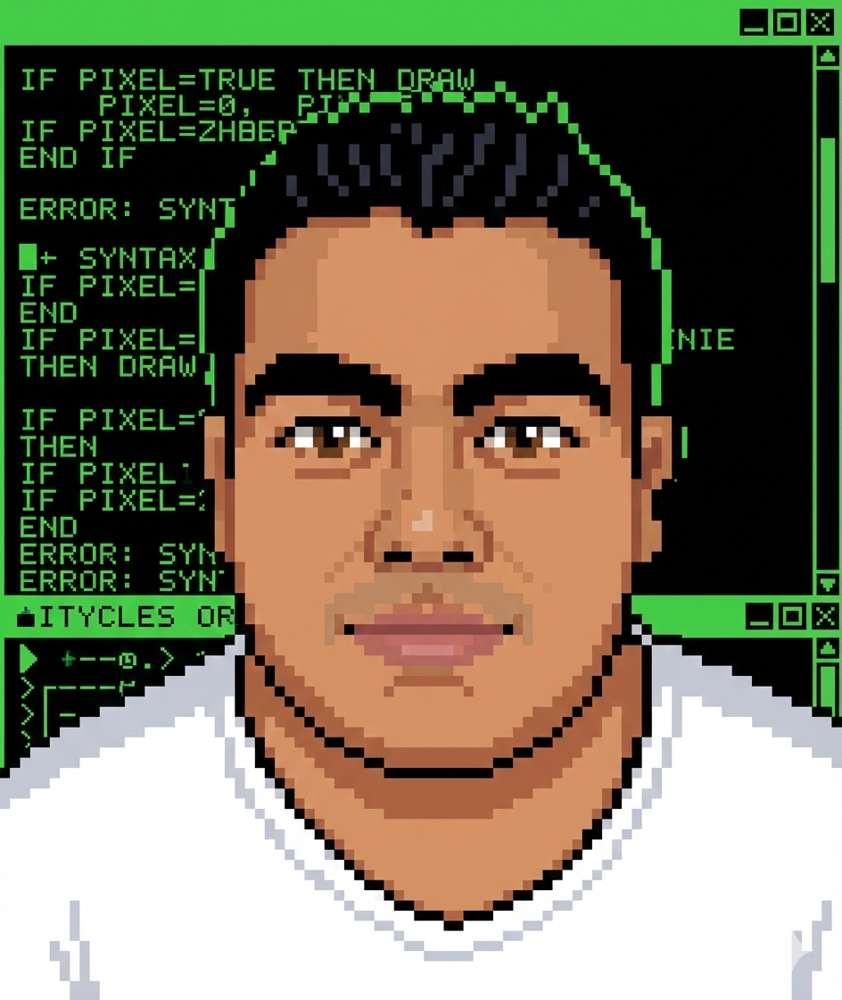

<h1 align="center">
Hi, I'm Pablo Adrián!
  </h1>
 <!---->
  <a href="https://github.com/Pablo-ProfeTechMike"> </a> 
<br/>

<!-- Typing SVG by DenverCoder1 - https://github.com/DenverCoder1/readme-typing-svg -->
<p align="center">
  <a href="https://github.com/Pablo-ProfeTechMike"></a>
</p>


<hr>

```
I-am-Pablo Adrián
-------------------------
💻 Freelance Ingeniero de Software y Soporte Integral | Experto en Desarrollo Multi-lenguaje, IA y Ciberseguridad | Docente
-------------------------
Soy un informático freelance emprendedor y amante de la tecnología. Mi camino en la tecnología ha sido una constante evolución. Tras superar los primeros desafíos al egresar en 2021, decidí transformar cada puerta cerrada en una oportunidad de aprendizaje y crecimiento.

En 2024 di un paso decisivo al consolidarme como profesional Freelance, ofreciendo soluciones integrales en desarrollo de software a medida, diagnóstico y reparación de equipos, y optimización de infraestructura tecnológica. Mi pasión por la enseñanza y la tecnología me llevó en 2025 a fundar profetechmike, un proyecto educativo y startup con el que busco democratizar el conocimiento técnico y construir soluciones innovadoras para la comunidad. Me especializo en traducir necesidades complejas en sistemas funcionales, diagnosticar infraestructura y facilitar el aprendizaje de herramientas digitales. Busco constantemente nuevas oportunidades para aportar valor técnico, versatilidad y trabajo colaborativo.

¿Buscas colaborar o impulsar un proyecto tecnológico? Hagamos contacto. Desarrollo Web/Software | Soporte Técnico & Redes | Docencia en Línea | Fundador de profetechmike.
```
<hr>


## Desarrollador Full-Stack

Cuento con tres años de experiencia como desarrollador freelance, especializado en el diseño y creación de aplicaciones móviles y sitios web en diversas plataformas. Durante este tiempo, he perfeccionado mis habilidades de programación y el dominio de múltiples lenguajes de desarrollo para entregar soluciones eficientes y a la medida.

## AI Integrator & Prompt Engineer

Especialista en conectar modelos Gemini, ChatGPT y Claude a productos de software reales mediante APIs, agentes autónomos, RAG(Retrieval-Augmented Generation) y optimización de prompts.

## Formulas en Excel

Como freelancer, automatizo y mejoro la estructura de bases de datos en Excel a través del desarrollo de fórmulas, garantizando un procesamiento e ingreso de información exacto y ágil.

## Documentación

Especialista independiente en la creación de documentación técnica, diseño gráfico básico, automatización de fórmulas y diagramas estructurados en Microsoft Word.

## Presentaciones

Como diseñador freelance, transformo ideas en presentaciones visuales e impactantes en PowerPoint.

## Algorítmo

Desarrollo algoritmos, diagramas de flujo y pseudocódigo de forma freelance.

## Soporte Técnico

Cuento con experiencia en diagnóstico de hardware y software, optimización de rendimiento (actualización de memoria RAM y SSD), formateo de sistemas operativos e instalación de drivers. Adicionalmente, configuro unidades externas y herramientas booteables, aplicando buenas prácticas de ciberseguridad para proteger la información del usuario.

## Base de Datos

Experto en arquitectura de datos, creación de diagramas entidad-relación y desarrollo en MySQL.

## Robótica

Como freelancer, disfruto dar vida a proyectos de robótica casera utilizando Arduino.

### 👨‍💻 Habilidades

<p>
    <a href="https://github.com/search?q=user%3ADenverCoder1+is%3Arepo+language%3Acss"></a>
    <a href="https://github.com/search?q=user%3ADenverCoder1+is%3Arepo+language%3Ahtml"></a>
    <a href="https://github.com/search?q=user%3ADenverCoder1+is%3Arepo+language%3Ajava"></a>
    <a href="https://github.com/search?q=user%3ADenverCoder1+is%3Arepo+language%3Ajavascript"></a>
    <a href="https://github.com/search?q=user%3ADenverCoder1+is%3Arepo+language%3Ajavascript"></a>
    <a href="https://github.com/search?q=user%3ADenverCoder1+is%3Arepo+language%3Aphp"></a>
    <a href="https://github.com/search?q=user%3ADenverCoder1+is%3Arepo+language%3Apython"></a>
    <a href="https://github.com/search?q=user%3ADenverCoder1+is%3Arepo+language%3Asql"></a>
      <a href="#"></a>
<a href="#"></a>
<a href="#"></a>


### 🧰 Frameworks and Libraries

<p>
    <a href="#"></a>
    <a href="#"></a>
    <a href="#"></a>
    <a href="#"></a>

</p>

### 🗄️ Databases and Cloud Hosting

<p>
    <a href="#"></a>
    <a href="#"></a>
</p>

### 💻 Software and Tools

<p>
    <a href="#"></a>
    <a href="#"></a>
    <a href="#"></a>
    <a href="#"></a>
</p>

## Redes Sociales

<a href="https://www.twitch.tv/profetechmike"></a>
    <a href="https://www.tiktok.com/@profetechmike0"></a>
    <a href="https://www.instagram.com/profetechmike"></a>
    <a href="https://www.facebook.com/people/Profetechmike-Bigherreralab/61577086169921/"></a>
 [](https://www.youtube.com/@bigherreralab)
  <a href="https://github.com/Pablo-ProfeTechMike"></a>
    <a href="https://www.linkedin.com/in/pablo-adri%C3%A1n-herrera-amieva-a86117184/"></a>

## GitHub Stats

[](https://github.com/stats-organization/github-stats-extended)


